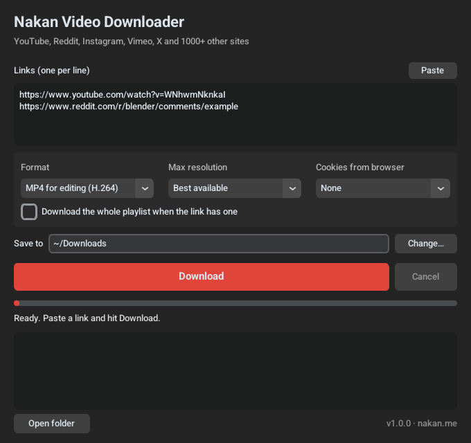

# Nakan Video Downloader

Download videos from YouTube, Reddit, Instagram and 1000+ sites as MP4 files ready for After Effects and Premiere. No terminal, nothing to install.



I used to keep a note with yt-dlp commands and paste them into the terminal every time I needed a reference video. It works, but it means installing yt-dlp and ffmpeg, remembering flags, and then re-encoding because After Effects doesn't open VP9 or AV1. So I wrapped all of that in a small window. It's the same engine underneath (yt-dlp), with the settings I always use already in place. I hope it saves you some time too.

## Features

- **Nothing to install by hand.** ffmpeg comes inside the app. On first launch it downloads yt-dlp and Deno (the JavaScript runtime YouTube now requires) from their official GitHub releases, and keeps yt-dlp updated once a day.
- **MP4 that editing apps open.** In *MP4 for editing* mode it picks the best quality and only re-encodes to H.264 / AAC when the source isn't already, so 1080p usually downloads with no conversion and 4K VP9/AV1 gets converted at high quality (CRF 18).
- **Original** mode keeps the file untouched, and **Audio only** saves an MP3.
- **Max resolution** cap (4K, 1440p, 1080p, 720p) to skip long downloads and conversions.
- **Cookies from your browser** for sites that need you logged in, like Instagram.
- Several links at once, one per line, and whole playlists when you want them.
- Windows and macOS (Apple Silicon and Intel).

## Download

Get the latest version from [Releases](../../releases/latest):

- **Windows:** `Nakan-Video-Downloader-Windows.exe`
- **Mac with Apple chip (M1 and newer):** `Nakan-Video-Downloader-macOS-AppleSilicon.dmg`
- **Mac with Intel:** `Nakan-Video-Downloader-macOS-Intel.dmg`

The app isn't signed with a paid Apple/Microsoft certificate, so the first time you open it:

- **Windows:** if SmartScreen shows "Windows protected your PC", click **More info → Run anyway**.
- **macOS:** drag the app to Applications and open it. If macOS says it can't verify the app, go to **System Settings → Privacy & Security**, scroll down and click **Open Anyway**. (Or run `xattr -cr "/Applications/Nakan Video Downloader.app"` in Terminal.)

## How to use

1. Open the app. On the first launch, wait a moment while it downloads its components (about 80 MB, only once).
2. Copy the video link from your browser and click **Paste** (or paste it in the box). You can add several links, one per line.
3. Choose the **Format**:
   - *MP4 for editing (H.264)* for After Effects, Premiere, Resolve, etc.
   - *Original (no conversion)* for the exact file the site serves.
   - *Audio only (MP3)*.
4. Optionally set a **Max resolution**.
5. For Instagram, private or age-restricted videos, choose the browser where you're logged in under **Cookies from browser**. On Windows, Firefox is the most reliable; Chrome needs to be fully closed. On Mac, Safari may ask for Full Disk Access.
6. Check **Save to** (Downloads by default) and click **Download**.
7. When it's done, click **Open folder** to find the file.

If something fails, the box at the bottom shows yt-dlp's message and the status line suggests what to try.

## Building from source

```
pip install --only-binary=:all: imageio-ffmpeg
pip install -r requirements-build.txt
python build.py
```

Pushing to `main` (or a tag like `v1.0.0`) builds Windows and macOS versions on GitHub Actions and attaches them to a Release named after the VERSION in the code.

## Credits

Built on [yt-dlp](https://github.com/yt-dlp/yt-dlp), [Deno](https://deno.com), [FFmpeg](https://ffmpeg.org) (via [imageio-ffmpeg](https://github.com/imageio/imageio-ffmpeg)) and [CustomTkinter](https://github.com/TomSchimansky/CustomTkinter). See [NOTICE.md](NOTICE.md).

Please only download content you have the right to use.
